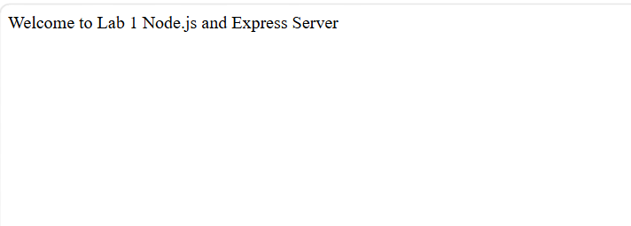
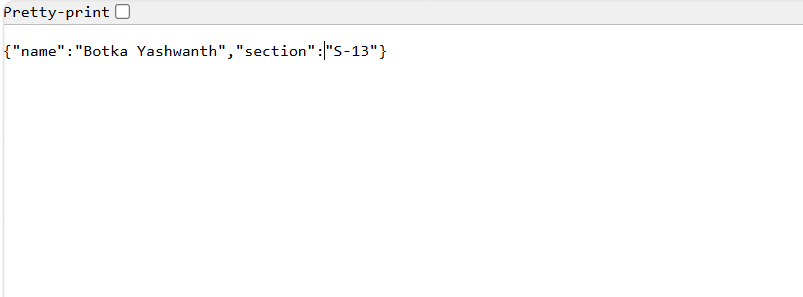
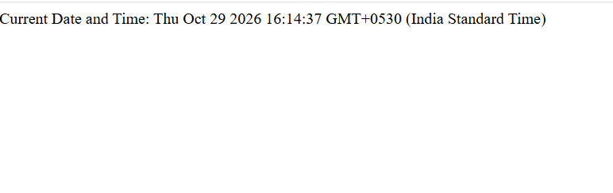
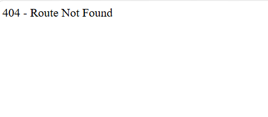

# Lab 1: Node.js and Express server

## Student Details
- **Name:** Botka Yashwanth
- **Registration Number:** 252U1R8011
- **Section:** S-13 *(Note: Please update if your official section differs)*


---

## Live Link
https://college-labs-xzu5.onrender.com

---

## How to Run

### 1. Prerequisites
Ensure you have Node.js and npm installed on your machine.
- Node.js: `v18+` or later
- npm: `v9+` or later

### 2. Installation
Navigate to the `lab-01` directory and install the required dependencies:
```bash
cd lab-01
npm install
```

### 3. Running the Plain Node.js HTTP Server
To run the plain built-in HTTP server:
```bash
node server-http.js
# or via npm script
npm run start:http
```
The server will start listening at: `http://localhost:3000/`

### 4. Running the Express Server
To run the primary Express server:
```bash
node server.js
# or via npm script
npm start
```
The Express server will start listening at: `http://localhost:3000/`

---

## Endpoints

| Method | Path | Description | Expected Status | Response Type |
|---|---|---|---|---|
| `GET` | `/` | Returns the welcome message | `200 OK` | Text (`text/plain` or `text/html`) |
| `GET` | `/about` | Returns student name and section | `200 OK` | JSON (`application/json`) |
| `GET` | `/time` | Returns the current server date and time using `new Date()` | `200 OK` | Text |
| `GET` | Any unknown path (e.g. `/unknown`) | Catch-all 404 handler returning route not found error message | `404 Not Found` | Text |

---

## Screenshots

### 1. Home Route (`GET /`)


### 2. About Route (`GET /about`)


### 3. Time Route (`GET /time`)


### 4. 404 Not Found Route (`GET /unknown`)


---

## Notes

### Problems Faced and How They Were Solved
- **Port Conflict Management:** Both `server-http.js` and `server.js` are configured to listen on port `3000`. Running both simultaneously would cause an `EADDRINUSE` port collision error. This was resolved by ensuring each server runs independently and stopping one before starting the other.
- **Handling Unknown Routes with Correct 404 Status:** In Express, unmatched routes must explicitly set `res.status(404)` before sending the response string so that the HTTP protocol status code matches the error response instead of defaulting to 200 OK.

