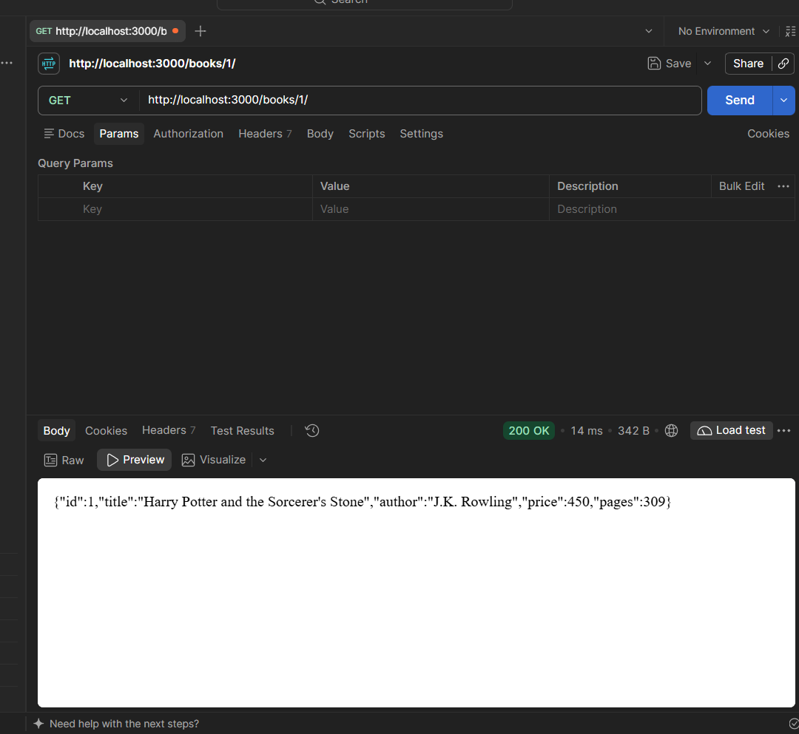
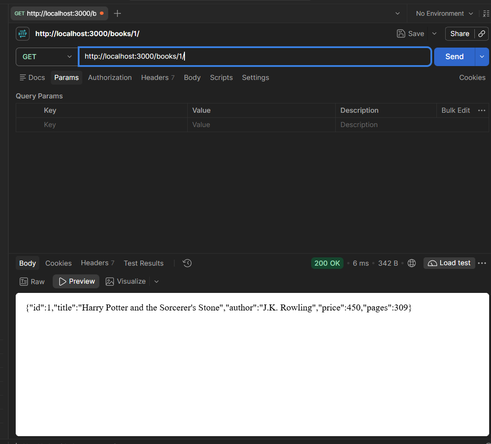
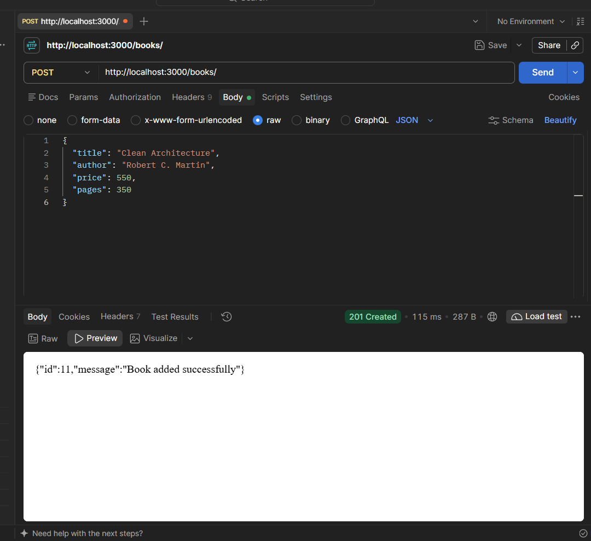
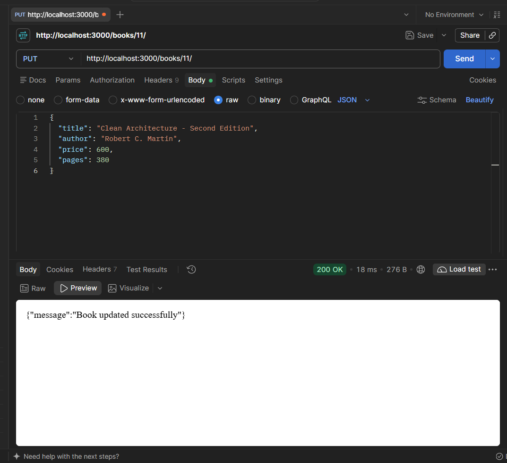
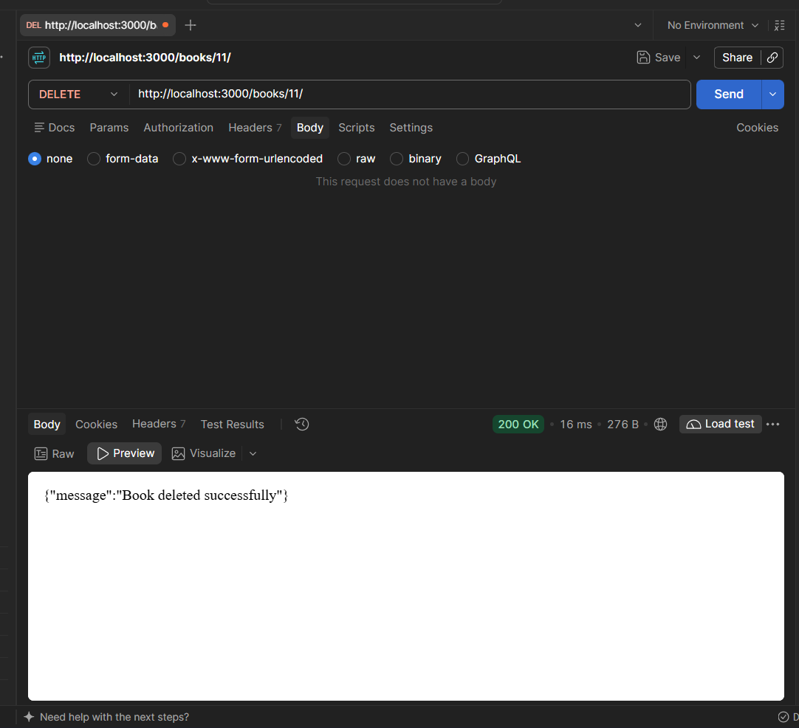
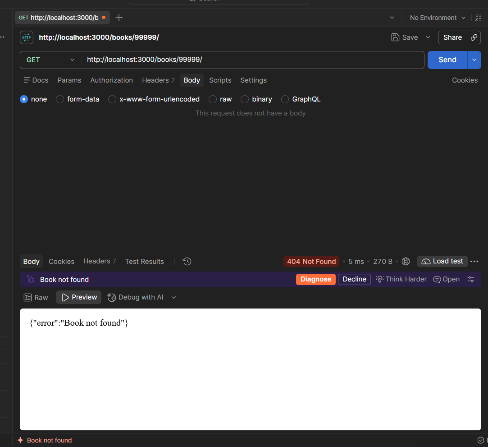
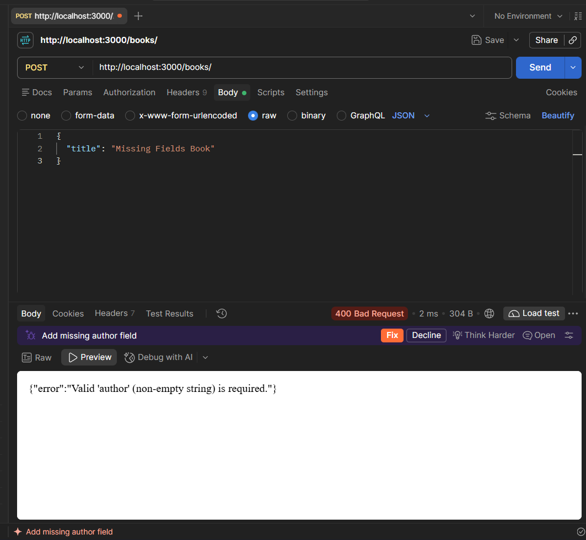
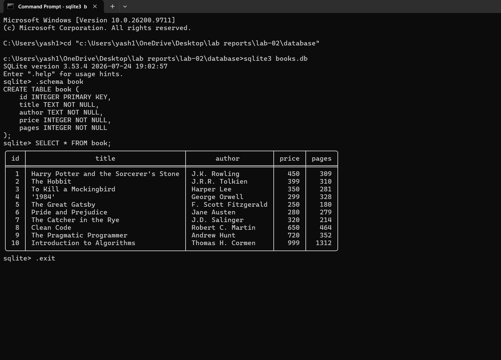

# Lab 2: SQLite database and CRUD routes

## Student Details
- **Name:** Botka Yashwanth
- **Registration Number:** 252U1R8011
- **Section:** S-13

---

## Live Link
https://college-labs-lab-02.onrender.com

---

## Project Description
This project implements a RESTful API with full CRUD (Create, Read, Update, Delete) capabilities for managing a library of books. It is built using **Node.js**, **Express**, and **SQLite** (using the `sqlite` and `sqlite3` drivers). The application initializes the SQLite database connection asynchronously prior to starting the HTTP server, and uses parameterized SQL queries with `?` placeholders across all routes to prevent SQL injection vulnerabilities.

---

## Requirements & Dependencies
- **Runtime:** Node.js (v18+ or v20+)
- **Package Manager:** npm (v9+ or v11+)
- **Dependencies:**
  - `express`: Minimalist web framework for routing and JSON parsing
  - `sqlite`: Promise-based wrapper around sqlite3 for async/await support
  - `sqlite3`: Native SQLite3 database driver
- **DevDependencies:**
  - `nodemon`: Utility that monitors for code changes and automatically restarts the development server

---

## How to Install and Run

### 1. Installation
Navigate into the `lab-02` directory and install the required dependencies:
```bash
cd lab-02
npm install
```

### 2. Running in Development Mode (Nodemon)
Start the server with automatic reloading upon file changes:
```bash
npm run dev
```

### 3. Running in Production Mode
Start the standard Node.js server:
```bash
npm start
```

### 4. Environment Variables
No `.env` file or environment variables are required. The server defaults to port `3000` (or uses `process.env.PORT` if provided by a cloud environment).

---

## Database Configuration

- **Database File:** `database/books.db`
- **Initialization Script:** `database/init.sql`

### Table Schema: `book`
```sql
CREATE TABLE book (
    id INTEGER PRIMARY KEY,
    title TEXT NOT NULL,
    author TEXT NOT NULL,
    price INTEGER NOT NULL,
    pages INTEGER NOT NULL
);
```

### Initial Seed Data
The database is pre-seeded with 10 classic and technical book records:
1. *Harry Potter and the Sorcerer's Stone* — J.K. Rowling (Price: 450, Pages: 309)
2. *The Hobbit* — J.R.R. Tolkien (Price: 399, Pages: 310)
3. *To Kill a Mockingbird* — Harper Lee (Price: 350, Pages: 281)
4. *1984* — George Orwell (Price: 299, Pages: 328)
5. *The Great Gatsby* — F. Scott Fitzgerald (Price: 250, Pages: 180)
6. *Pride and Prejudice* — Jane Austen (Price: 280, Pages: 279)
7. *The Catcher in the Rye* — J.D. Salinger (Price: 320, Pages: 214)
8. *Clean Code* — Robert C. Martin (Price: 650, Pages: 464)
9. *The Pragmatic Programmer* — Andrew Hunt (Price: 720, Pages: 352)
10. *Introduction to Algorithms* — Thomas H. Cormen (Price: 999, Pages: 1312)

### Inspecting Database via SQLite CLI
Open the database in your terminal:
```bash
sqlite3 database/books.db
```
Useful commands inside the SQLite shell:
```sql
.tables
.schema book
SELECT * FROM book;
.exit
```

---

## API Endpoints

| Method | Endpoint Path | Description | Request Body (JSON) | Success Status | Error Statuses |
|---|---|---|---|---|---|
| `GET` | `/books/` | Retrieves all book records | *None* | `200 OK` | `500 Internal Server Error` |
| `GET` | `/books/:bookId/` | Retrieves a single book by ID | *None* | `200 OK` | `400 Bad Request`<br>`404 Not Found`<br>`500 Internal Server Error` |
| `POST` | `/books/` | Adds a new book to the database | `{"title": "...", "author": "...", "price": 0, "pages": 0}` | `201 Created` | `400 Bad Request`<br>`500 Internal Server Error` |
| `PUT` | `/books/:bookId/` | Updates an existing book by ID | `{"title": "...", "author": "...", "price": 0, "pages": 0}` | `200 OK` | `400 Bad Request`<br>`404 Not Found`<br>`500 Internal Server Error` |
| `DELETE` | `/books/:bookId/` | Deletes a book by ID | *None* | `200 OK` | `400 Bad Request`<br>`404 Not Found`<br>`500 Internal Server Error` |

---

## Screenshots

### 1. Get All Books (`GET /books/`)


### 2. Get Single Book (`GET /books/1/`)


### 3. Add a Book (`POST /books/`)


### 4. Update a Book (`PUT /books/:bookId/`)


### 5. Delete a Book (`DELETE /books/:bookId/`)


### 6. Book Not Found 404 Route (`GET /books/99999/`)


### 7. Invalid Input 400 Route (`POST /books/` with invalid body)


### 8. SQLite Database Verification (CLI)


---

## Notes

### Problems Faced and How They Were Solved
- **Asynchronous Startup Sequencing:** Express routes can receive traffic immediately if `app.listen()` is called synchronously at file evaluation time, causing database queries to fail with `Cannot read properties of null` before the SQLite file is opened. This was solved by structuring startup inside `initializeDBAndServer()`, which awaits `open(...)` before executing `app.listen(...)`.
- **SQL Injection Prevention:** Directly interpolating user values from `req.params` or `req.body` into SQL strings creates severe SQL injection security vulnerabilities. This was solved by employing parameterized queries (`?` placeholders) with arrays of sanitized parameters passed directly to the SQLite query engine.
- **Path Resolution Stability:** Opening SQLite using relative strings like `./database/books.db` causes errors if the terminal runs from different directories (e.g. repo root vs `lab-02/`). Using `path.join(__dirname, "database", "books.db")` guarantees a stable absolute path regardless of current working directory.

